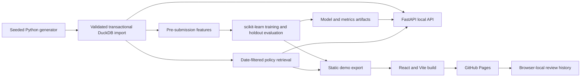
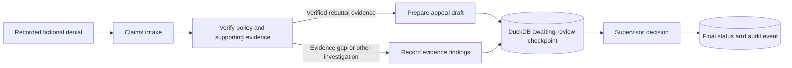

# Healthcare Claims Denial Copilot

A portfolio project for **Willow Creek Health**, a fictional provider. Billing specialists review claim lines by predicted denial risk. Denial analysts compare recorded payer reasons with claim evidence and the policy effective on the service date. Managers see denial trends and review volume.

The project generates every member, claim, response, policy and historical review. The synthetic holdout measures performance on the generator's patterns. Use the project with fictional data only.

## Demo walkthrough

1. Open **Claim queue**, filter to **Pre-submission**, and select **Start guided case**. Check the MRI line's risk score and missing authorization record.
2. Select **Simulate payer response**. The MRI line is denied for prior authorization, the companion lab line is approved, and the overall claim is partially denied. The cited Northstar imaging policy is **NS-IMG-v2**, effective July 1, 2025.
3. In **Ask about this claim**, try “Why was this line denied?” or “Which policy applied on the service date?” You can also type your own question, such as “How much was billed and who is the payer?” Answers use the selected line’s records and reflect whether its payer response has been revealed. Select **Use microphone** in a browser that supports speech recognition, allow microphone access, and speak a question. Select **Stop microphone**, edit the transcription as needed, and select **Ask**. The browser may send audio to its speech recognition service. Type your question if voice input is unavailable. Earlier questions are available in the current claim view. The demo gives a fallback when a question requires unavailable data or falls outside its supported topics.
4. In **Analyst decision**, choose an action, enter an optional note, and select **Save decision**. Reload and reopen the case to see the saved review.
5. Select **Open earlier policy case**, then simulate the response. The June 30, 2025 service resolves to **NS-IMG-v1**, which allows authorization up to two business days after service.
6. Open **Manager dashboard** for monthly denial rates and review volumes. **Unmatched responses** shows a payer response with no matching billing line. When an applicable policy passage is missing, the detail view keeps the recorded reason and suggests requesting payer clarification.

### Browser and API modes

**Static demo.** React reads the generated `demo.json` and simulates the guided payer responses. Decisions and revealed responses persist in local storage for the current browser and origin. The demo needs no backend or credentials. Clear the site's storage to reset it.

**Live local API.** FastAPI opens the generated DuckDB file and loads the trained model for queue scoring. The API exposes ranked lines, existing responses, policy retrieval, and decisions persisted in DuckDB. The static React demo uses its exported snapshot. Browse or exercise the API at [local Swagger UI](http://127.0.0.1:8000/docs).

## Architecture



## Data dictionary

All identifiers are stable within the default seeded extract. Dates use ISO 8601. Eligibility, authorization and policy periods include the start date and exclude the end date.

| DuckDB table | Identifier and fields |
| --- | --- |
| `claims` | `id`, fictional `member`, `payer`, `submitted` date |
| `lines` | `id`, `claim_id`, `procedure`, `service` date, billed `amount` in whole USD |
| `eligibility` | `id`, `member`, `payer`, coverage `starts` and `ends`, extract `recorded` date |
| `authorizations` | `id`, `member`, `payer`, `procedure`, authorization `starts` and `ends`, extract `recorded` date |
| `responses` | `id`, referenced `line_id`, `status`, recorded `reason` code, `received` date |
| `policies` | versioned `id`, `payer`, `procedure`, effective `starts` and `ends`, `section`, fictional `excerpt` |
| `decisions` | `id`, denied `line_id`, review `action`, optional `note` |

The importer accepts identical replays, rolls back conflicting IDs and invalid extracts, and retains unmatched payer responses. Each line has at most one response in this dataset. Claims with both approved and denied lines are partially denied. Other claims with unresolved lines are pending. An absent eligibility or authorization record can coexist with an approved response.

## Model results

The model uses logistic regression with a training-fitted `DictVectorizer`. Predictors are payer, procedure, missing matching eligibility, missing matching imaging authorization, and a possible duplicate. Evidence must be in the extract before submission. A possible duplicate uses an earlier submitted claim or a preceding line within the same claim. Responses, response reasons and analyst decisions supply no predictive features.

The chronological split uses submission dates. Training uses 2,674 finalized lines with both submission and response before September 1, 2025. The later holdout has 1,248 finalized lines, including 317 denials. Pending and walkthrough lines are excluded from evaluation. The rules baseline weights missing eligibility at 0.55, missing imaging authorization at 0.38, and possible duplicates at 0.48.

| Method | PR-AUC (average precision) | ROC-AUC | Precision at 3 reviews/day | Recall at 3 reviews/day |
| --- | ---: | ---: | ---: | ---: |
| Logistic regression | 0.7946 | 0.9270 | 66.04% | 66.25% |
| Rules baseline | 0.7126 | 0.9101 | 63.52% | 63.72% |

The logistic model’s Brier score on the holdout is **0.0841**. The rules produce ranking scores rather than calibrated probabilities.

Precision pools up to three top-ranked holdout lines per submission day and breaks ties by stable ID. Each method selects 318 lines. The holdout and dashboard cover the generated population eligible for their respective calculations. The browser queue includes all generated claim lines, including the walkthrough claims. Search and status filters apply to the entire ranked queue, which displays 25 lines per page.

Policy retrieval filters by payer, procedure and service date, then ranks sections by overlap with terms tied to the recorded reason. Each denial displays one suggested action. All explanations are deterministic and run locally.

## Local commands

Python 3.12 and Node.js 22 are used in CI.

```sh
python -m venv .venv
source .venv/bin/activate
python -m pip install -r requirements.txt
python -m scripts.export_demo
python -m pytest -q
```

The pipeline writes `artifacts/claims.duckdb`, `artifacts/model.joblib`, `artifacts/metrics.json`, `artifacts/scored_claim_lines.json`, and `apps/frontend/public/demo.json`. Rebuild with the same seed to reproduce the snapshot. The DuckDB build also preserves decisions saved through the API.

```sh
python -m uvicorn apps.api.main:app --host 127.0.0.1 --port 8000
```

API routes include `GET /api/queue`, `GET /api/metrics`, `GET /api/unmatched-responses`, `GET /api/lines/{line_id}`, and `POST /api/lines/{line_id}/decisions`. A decision body can be `{"action":"Verify authorization","note":"Check the payer portal"}`.

```sh
cd apps/frontend
npm ci
npm run check
npm run build
npx playwright install chromium
npm test
npm run preview
```

For frontend development use `npm run dev`. Playwright runs both desktop and mobile profiles against the production build. Set `CLAIMS_CHROMIUM_PATH` to use an installed Chromium executable.

## GitHub Pages

Create the public repository `healthcare-claims-denial-copilot`, then choose **Settings → Pages → Build and deployment → Source → GitHub Actions**. Push `main` or dispatch **Checks and GitHub Pages** after enabling Pages.

The workflow regenerates and checks the committed export, runs Python tests, type-checks and builds React, and runs desktop and mobile browser tests. A successful `main` build publishes `apps/frontend/dist` and checks the deployed HTML and JSON. The Actions deployment job displays the Pages URL.

### Animated background theme

Open [the standalone theme](https://varunreddyguvvala.github.io/healthcare-claims-denial-copilot/theme.html) or load `apps/frontend/public/theme.html` directly in a browser. The three scenes use self-contained fictional examples and zero network requests. Use `#strip`, `#rail`, or `#form` to link to a specific scene.

### Batch claim review

Choose **Batch claim review** to analyze 5,000 generated synthetic claim lines, upload your own fictional records, or enter one line manually. Import up to 5,000 records across JSON files with a combined limit of 10 MB. A JSON file can contain one object or an array of objects. **Download sample JSON** generates the full example batch. PDF and image documents require separate extraction into the JSON format.

```json
{
  "id": "TEST-0001",
  "payer": "Northstar Health",
  "procedure": "IMG-01",
  "service": "2025-06-30",
  "eligible": "yes",
  "duplicate": "no",
  "authorization": "yes",
  "authorizationDate": "2025-07-01"
}
```

Each line ID must be unique. Dates use YYYY-MM-DD. `eligible`, `duplicate`, and `authorization` accept `yes`, `no`, and `unknown`, and default to `unknown` when omitted. These fields express the submitter’s evidence. A confirmed exception under a matched fictional policy can produce a denial recommendation. Missing evidence or a missing policy can require analyst review. The demo counts Monday through Friday as business days for Northstar imaging Version 1 and asks for human review when a Version 2 authorization date equals the service date.

Upload processing and recommendations stay in the current browser view. Export results before leaving the view if you need a copy. The batch workflow uses policy and evidence rules. Its outputs are portfolio-demo recommendations for analyst review.

### Ledger theme

The main interface uses the Ledger theme. The queue capacity slider previews the cutoff for the current ranked list and compares model and rules denials caught at the selected daily capacity on the fixed holdout. Deferred rows free a queue slot for the current session. Manager charts use the same holdout capacity simulation. The review grid groups historical and browser-local reviews by claim submission date. The today marker appears on the daily columns when today is in the displayed data range.

Open **Review March 2026 case** to see the January–June timeline. The treatment date of March 30 resolves to Version 1, even though submission and denial fall after the April 1 change. Scrubbing the date previews another policy while keeping the recorded dates, reason, and original policy citation intact. Compare policy versions below the ruler to see the changed wording.

## Enterprise investigation workflow

The Pages demo runs from a reproducible export. The local API adds a deterministic LangGraph investigation with evidence intake, service-date citation verification, conditional appeal drafting, and an analyst-to-supervisor handoff. The appeal is an internal draft. The API never transmits it to a payer.



### Local application

From the repository root, set separate local analyst and supervisor tokens before starting Docker Compose. Keep these values out of Git.

```sh
export COPILOT_ANALYST_TOKEN="$(openssl rand -hex 32)"
export COPILOT_SUPERVISOR_TOKEN="$(openssl rand -hex 32)"
docker compose up --build -d
docker compose ps
```

If your build network uses a trusted TLS inspection CA, build with `docker build -f infrastructure/docker/Dockerfile --secret id=claims_build_ca,src=/path/to/trusted-ca-bundle.pem -t healthcare-claims-denial-copilot-copilot .`, then run `docker compose up --no-build -d`. The build uses the optional bundle only while installing dependencies.

Open [the authenticated local workflow](http://localhost:8000/?mode=api). Open **Review March 2026 case**, simulate the response, then start the **Local investigation** with the analyst token. The evidence includes the January authorization and the Version 1 policy. Save the investigation ID to reopen it after a service restart. Enter the supervisor token, a review note, and an approval or rejection to record the final review.

You can also run without Docker after generating the artifacts. Build with `npm ci && npm run build` inside `apps/frontend`, then from the repository root run `COPILOT_SERVE_UI=1 python -m uvicorn apps.api.main:app`. Set the same two tokens in that shell. The investigation UI appears only on loopback hosts.

| Operation | Endpoint | Role |
| --- | --- | --- |
| Start | `POST /api/investigations` with `{"line_id":"CLM-LEDGER-1"}` | Analyst or supervisor |
| Reopen | `GET /api/investigations/{id}` | Analyst or supervisor |
| Record final review | `POST /api/investigations/{id}/decision` with `{"decision":"approve","note":"Verified synthetic evidence."}` | Supervisor |

The API requires bearer tokens for claims routes when configured in full local mode. The investigation routes always require distinct tokens of at least 24 characters. A process lock and DuckDB transaction protect the single-process workflow checkpoint and audit event. Role tokens are local demo credentials and represent roles rather than individual identities. The repository contains fictional data only.

### Local MCP

In your Python environment, run `python -m mcp_server.server` as a stdio MCP server from the repository root after generating artifacts. It exposes two read-only tools, `applicable_policies` and `claim_evidence`. The DuckDB file is accessed directly, so run the tool when no separate process holds an open write connection.

### Delivery scope

This iteration covers the existing static portfolio demo and the local investigation slice. The current dataset, deterministic policy matcher, and logistic regression baseline remain the foundation. The million-line streaming lakehouse, additional model families, vector and hosted-LLM integrations, production identity and observability, and AWS deployment profiles are separate phases. No paid infrastructure is needed to run the demo.


## Repository layout

See the [repository map](docs/architecture.md#repository-map), [data dictionary](docs/data_dictionary.md), [model card](docs/model_card.md), [agent design](docs/agent_design.md), [API reference](docs/api_reference.md), [security notes](docs/security.md), [deployment guide](docs/deployment.md), and [walkthrough](docs/demo_walkthrough.md).

From the repository root, run `make data`, `make train`, and `make evaluate` for separate pipeline stages. Run `make export` for the reproducible end-to-end artifact build and `python -m evaluation.rag.evaluate_policies` for the synthetic policy citation cases.

## Model governance experiment

Open **Manager dashboard → Model governance** to compare logistic regression, random forest, histogram gradient boosting, and the rules baseline. The report separates validation selection from release gates on frozen test and includes calibration, payer and procedure slices, and feature drift. [Experiment design and measured results](docs/model_governance.md)

## Synthetic data at scale

Build a validated local Parquet lakehouse with `python -m scripts.generate_lakehouse --preset large`. The large preset generates **1,000,000 claim lines**, **250,000 claims**, and **50,000 fictional members** over **36 service months**. Small and medium presets use the same schema. [Presets, tables, and reproduced counts](docs/synthetic_lakehouse.md)
