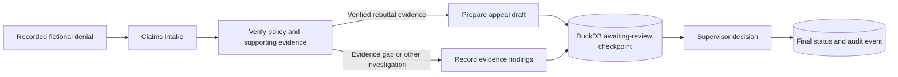

# Investigation workflow

The Pages demo runs from a reproducible export. The local API adds a deterministic LangGraph investigation with evidence intake, service-date citation verification, conditional appeal drafting, and an analyst-to-supervisor handoff. The appeal is an internal draft. The API never transmits it to a payer.

