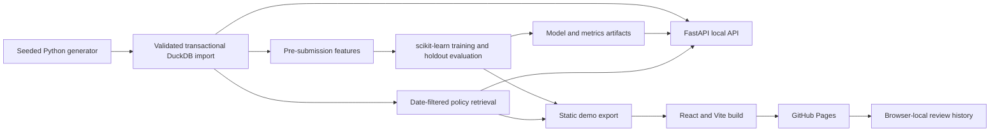

# Architecture

## Repository map

| Area | Working code |
| --- | --- |
| Web and API | `apps/frontend` and `apps/api` |
| Synthetic data and ETL | `data/generator`, `data/policies`, and `data_engineering/ingestion` |
| Model | `machine_learning/{feature_engineering,training,evaluation}` |
| Policy evidence | `generative_ai/retrieval` and `evaluation/{rag,golden_datasets}` |
| Investigation | `agentic_ai/workflows`, approval routes, and local DuckDB |
| MCP | `mcp_server/server.py` |
| Delivery | `infrastructure/docker`, `docker-compose.yml`, and reusable workflows |
| Verification | `tests/{unit,integration,contract,e2e}` |

The proposed lakehouse and streaming adapters, production observability, Terraform, Kubernetes, Helm, and hosted LLM components remain roadmap items. Generated databases and models live under ignored `artifacts/`.
